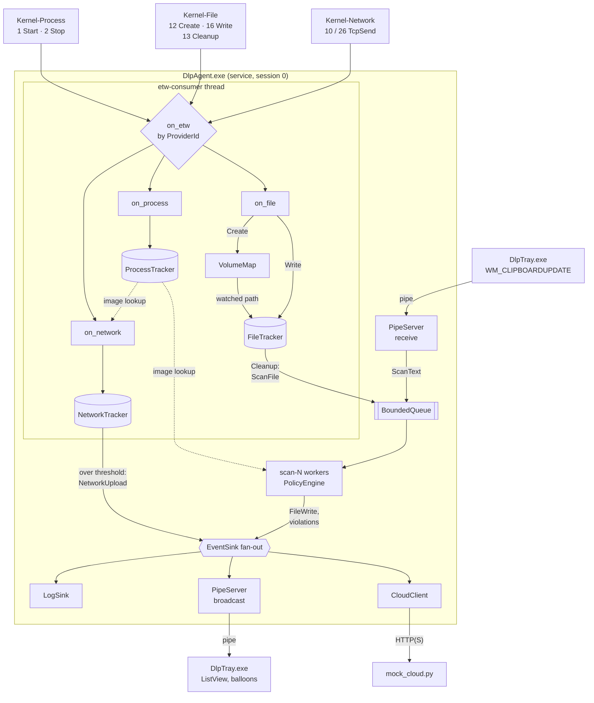

# Architecture

DLP Monitor is a user-mode endpoint DLP agent: a Windows service that watches file,
process and network activity through ETW, scans content against a policy, and reports
to a management backend. A per-user tray app shows events and covers the clipboard.

Four trigger points feed the agent. Three are kernel ETW events; the clipboard comes in
through the tray app because the service cannot see it.

Every handler on the ETW thread decodes the payload with `EventParser` before touching a
tracker. Network uploads skip the queue: there is no content to scan, only a byte count.
`ProcessTracker` emits nothing itself; it records each image path at process start so later
events can name the process even after it has exited.

| Trigger | Handler | State it updates | What it produces |
|---|---|---|---|
| Kernel-Process 1 / 2 | `Agent::on_process` | `ProcessTracker` (image path resolved through `VolumeMap`) | nothing directly; supplies `image` to every later event |
| Kernel-File 12 Create | `Agent::on_file` | `VolumeMap` decides if the path is watched → `FileTracker::on_create` | nothing yet |
| Kernel-File 16 Write | `Agent::on_file` | `FileTracker::on_write` adds `IOSize` | nothing yet |
| Kernel-File 13 Cleanup | `Agent::on_file` | `FileTracker::on_cleanup` removes the entry | `ScanFile` job → scan worker → `FileWrite` + violations |
| Kernel-Network 10 / 26 | `Agent::on_network` | `NetworkTracker::on_send` adds bytes per (pid, remote) | `NetworkUpload` event published directly when over threshold |
| Clipboard change | tray → pipe → `Agent::submit_text` | none | `ScanText` job → scan worker → violations |

## Threads and ownership

| Thread | Owns | Must not |
|---|---|---|
| `etw-consumer` (ProcessTrace) | `EventParser`, `FileTracker`, `NetworkTracker` (no locks) | block, do file I/O, allocate much |
| `scan-N` | one job at a time | hold locks while reading files |
| `housekeeping` | volume refresh, 60 s heartbeat | — |
| `pipe-accept`, `pipe-client` × N | one overlapped pipe each | block on a slow tray (5 s write timeout, then drop the client) |
| `cloud-sender`, `cloud-policy`, `cloud-ws` | HTTP connections, spool file | hold up shutdown (WinHTTP timeouts are 5–10 s) |

Shared state crosses threads in three places, each with a different tool:

* **Policy**: `std::atomic<std::shared_ptr<const Policy>>`. A scan takes a snapshot and
  keeps using it even if the cloud pushes a new policy mid-scan.
* **Volume table**: same immutable-snapshot pattern; refreshed every 5 s, read on every
  Create event.
* **Process table**: `std::shared_mutex`, since lookups far outnumber process starts.

## Why these choices

**ETW callback does no work.** If the consumer falls behind, ETW drops whole buffers for
the session and there is no way to know which events were lost. Dropping our own queued
jobs is preferable because they are counted (`queue_dropped` in the heartbeat) next to
ETW's own `EventsLost` / `RealTimeBuffersLost`.

**Event-ID filtering in the session.** `EnableTraceEx2` with `EVENT_FILTER_TYPE_EVENT_ID`
means Kernel-File reads, renames, etc. never reach user mode. The callback still checks
IDs because older builds may reject the filter (the agent then retries without it).

**Cleanup, not Close.** Kernel-File event 13 (Cleanup) fires when the last user handle is
closed. Close (14) waits for the last *reference*, and the cache manager keeps one on
cached files, sometimes until the volume is dismounted.

**Ignore our own PID.** The scanner opens each file it inspects, which produces Create and
Cleanup events. Without the PID check every scan would queue another scan of the same file.

**USB detection by bus type.** `GetDriveType` reports USB hard disks as `DRIVE_FIXED`;
`IOCTL_STORAGE_QUERY_PROPERTY` → `BusTypeUsb` catches them. Policy `monitored_paths` treats
a local folder as the USB channel so the pipeline can be tested without a stick.

**Clipboard in the tray app.** The service runs in session 0 and has no access to the
user's clipboard, so the tray reads it (`AddClipboardFormatListener`) and forwards the text
over the pipe. It skips content marked `ExcludeClipboardContentFromMonitorProcessing`
(password managers).

**Only masked samples leave the machine.** Detectors produce `************1111`-style
samples; raw content stays on the endpoint.

## Trust boundaries

| Boundary | Control |
|---|---|
| Policy file on disk | `%ProgramData%\DlpMonitor` created with a protected DACL (SYSTEM/Admins write, Users read); written with write-then-rename |
| Named pipe | DACL: SYSTEM, Admins, Interactive users; `PIPE_REJECT_REMOTE_CLIENTS`; `FILE_FLAG_FIRST_PIPE_INSTANCE` against squatting; one listening instance always kept; 1 MiB frame cap |
| Tray → agent messages | Untrusted input: parsed defensively. A user can only make the agent scan text they supply |
| Cloud policy | Fully validated (`Policy::parse`) before the swap; a bad policy is rejected and the old one is kept |
| Service binary path | Quoted in `CreateService` (unquoted-path hijack) |

## Limitations

* **Detect, not block.** ETW is asynchronous: when the event arrives, the write has already
  happened. Blocking requires the kernel components in [minifilter-wfp-design.md](minifilter-wfp-design.md).
* Text formats only. `.docx`/`.xlsx`/`.pdf` are compressed containers and are reported as
  "binary content not scanned"; a real product needs extractors (zip + XML, PDF text).
* Memory-mapped writes are seen as paging I/O from the System process; attribution then
  falls back to the PID that opened the file.
* The tray does not yet verify that the pipe server is the real agent (e.g. by checking
  that `GetNamedPipeServerProcessId` belongs to the `DlpMonitor` service).
* Volume changes are polled every 5 s rather than using device-arrival notifications.
