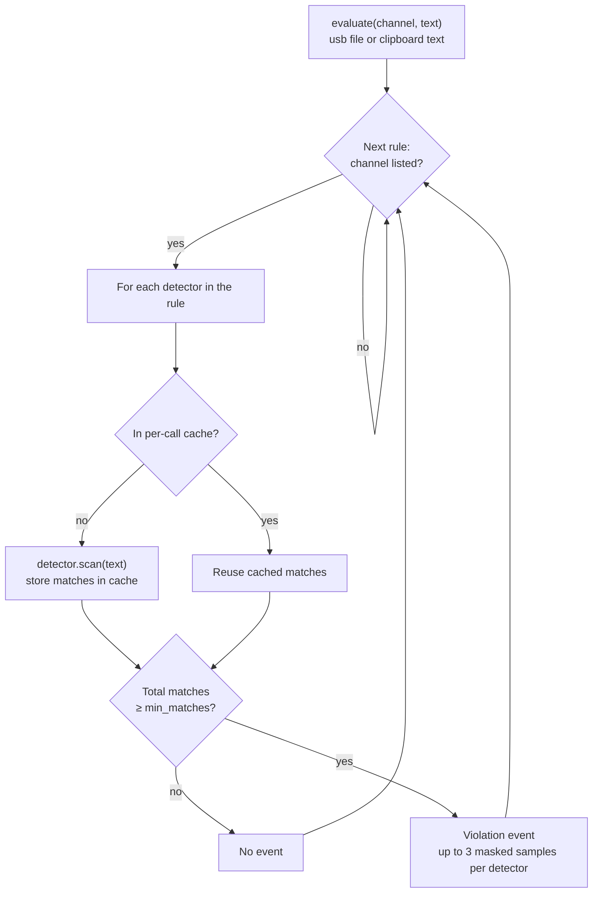

# Detectors and Policy Engine

How the agent decides that a piece of text is sensitive: which detectors run, how rules combine them, and what event comes out.

Content is **not** run through every detector. `PolicyEngine::evaluate` runs only the detectors referenced by rules bound to the content's channel, and each detector scans a given piece of content at most once.

> "Decoder" in this codebase means the named-pipe `FrameDecoder` ([pipe_protocol.h](../src/common/pipe_protocol.h)), which is unrelated. This document covers detectors.

## Overview

- **Detectors** ([detectors.cpp](../src/agent/detectors.cpp)) find one kind of sensitive data in UTF-8 text and return masked matches.
- **Policy** ([policy_engine.cpp](../src/agent/policy_engine.cpp)) is a JSON document of rules. Each rule binds channels to detectors and sets a match threshold, severity and action.
- **`PolicyEngine::evaluate(channel, text)`** is the single entry point. The agent calls it for files written to monitored paths (`usb`) and for clipboard text sent by the tray (`clipboard`). It returns one violation event per matching rule.

## Detectors

Every detector implements one interface and returns matches that are already masked, so raw sensitive values never leave the scan.

```cpp
class Detector {
public:
    virtual const std::string& name() const = 0;
    virtual void scan(std::string_view text, std::vector<Match>& out) const = 0;
};

struct Match {
    size_t offset = 0;
    std::string masked;  // safe to log / send to cloud
};
```

Detectors are hand-written linear scanners, not `std::regex`. `std::regex` backtracks recursively, is slow on multi-MB input and can overflow the stack.

| Name | Matches | Validation beyond the pattern | Masked sample |
| --- | --- | --- | --- |
| `credit_card` | 13-19 digits, single space or dash between groups | First digit 2-6, Luhn checksum, word boundaries | `************1111` (last 4 kept) |
| `tw_national_id` | One uppercase letter + 9 digits | Second digit 1, 2, 8 or 9; area-code checksum; word boundaries | `A*******89` (first 1, last 2 kept) |
| `aws_access_key` | `AKIA` + 16 uppercase letters or digits | Exact length, word boundaries | `AKIA********WXYZ` |
| `github_token` | `ghp_` + 36 alphanumerics | Exact length, word boundaries | `ghp_********abcd` |
| `email` | `local@domain.tld` around each `@` | Domain has a dot and a TLD of 2+ characters; trailing period trimmed | `j***@example.com` |
| keyword set | Any keyword from a named list in the policy | Case-insensitive for ASCII only | The keyword itself |

Built-in detectors come from `make_builtin_detector(name)`, which returns `nullptr` for an unknown name. Keyword detectors come from `make_keyword_detector(name, keywords)` and are defined entirely by the policy's `keywords` map.

Keyword matching lowercases ASCII only, so CJK keywords such as 機密 match byte-for-byte. Keyword matches are not masked because the keyword itself is not sensitive.

## Worked example: how `credit_card` recognizes a card number

Suppose the user copies this text and the tray sends it to the agent on the `clipboard` channel:

```
Please charge card 4111 1111 1111 1111.
```

`CreditCardDetector::scan` walks the text left to right:

1. **Find a candidate start.** It skips every character until it reaches a digit at a word start (the previous character is not a letter or digit). `P`, `l`, `e`… `card ` are skipped; the `4` after the space is a candidate.
2. **Collect digits.** From the `4` it collects up to 19 digits. A single space or dash is allowed only when a digit follows it, so `4111 1111 1111 1111` collects 16 digits: `4111111111111111`. The `.` stops collection.
3. **Length and boundary.** 16 is within 13-19, and the character after the number (`.`) is not alphanumeric, so the number is not glued to other text.
4. **Plausible prefix.** The first digit is `4` (Visa). Accepted first digits are 2-6 (Mastercard 2/5, Amex/Diners/JCB 3, Visa 4, Discover/UnionPay 6).
5. **Luhn checksum.** From the rightmost digit, every second digit is doubled (subtract 9 if the result is over 9), then all digits are summed:

   | Digits (right to left) | Doubled? | Contribution |
   | --- | --- | --- |
   | 8 × `1` at positions 0, 2, …, 14 | no | 8 |
   | 7 × `1` at positions 1, 3, …, 13 | yes, 1 → 2 | 14 |
   | `4` at position 15 | yes, 4 → 8 | 8 |
   | **Total** | | **30** |

   30 is divisible by 10, so the number passes.
6. **Mask and record.** The match is stored as `{offset: 19, masked: "************1111"}`. The raw number is never stored or sent.

Inputs that look similar but are rejected:

| Input | Rejected at | Why |
| --- | --- | --- |
| `4111 1111 1111 1112` | Step 5 | Luhn sum is 31, not divisible by 10. Luhn catches every single-digit typo, and random digits pass only 1 time in 10 |
| `Order 1234567890123` | Step 4 | First digit `1` is not a card network prefix |
| `0912-345-678` (phone) | Step 3 | Only 10 digits |
| `ID4111111111111111` | Step 1 | Digit is glued to the letters `ID`, so it is not a word start |
| `4111  1111 1111 1111` (two spaces) | Step 2 | Only single separators are allowed; collection stops at 4 digits |

When a candidate fails, the scanner skips the rest of that alphanumeric token instead of retrying from each following digit, so a long digit string is not rescanned.

The policy engine then turns the match into an event. The clipboard channel is bound to rule `pci-card`, whose only detector is `credit_card` with `min_matches: 1`. One match meets the threshold, so the engine emits:

```json
{
  "kind": "violation",
  "channel": "clipboard",
  "rule_id": "pci-card",
  "rule_name": "Payment card numbers",
  "severity": "high",
  "action": "alert",
  "matches": [
    { "detector": "credit_card", "count": 1, "samples": ["************1111"] }
  ],
  "pid": 1234,
  "image": "C:\\Windows\\System32\\notepad.exe",
  "target": "clipboard",
  "bytes": 39
}
```

`pid`, `image`, `target` and `bytes` are filled in by `Agent::handle(ScanText)`, not by the engine. The `pid` and `image` values above are illustrative.

## Policy format

A policy is one JSON document: global limits, optional keyword sets, and a list of rules that bind channels to detectors. The shipped default is [policy/default_policy.json](../policy/default_policy.json).

**Top-level fields**

| Field | Type | Default | Meaning |
| --- | --- | --- | --- |
| `version` | int | 0 | Policy version, reported with events |
| `scan_limit_bytes` | uint64 | 8388608 (8 MB) | Max bytes read from a file before scanning |
| `network_upload_threshold_bytes` | uint64 | 52428800 (50 MB) | Per-process upload volume that raises a network event |
| `monitored_paths` | string[] | empty | Path prefixes treated as the `usb` channel; lowercased on load |
| `keywords` | map of string to string[] | none | Named keyword sets usable as detector names |
| `rules` | Rule[] | required | See below |

**Rule fields**

| Field | Required | Default | Meaning |
| --- | --- | --- | --- |
| `id` | yes | | Stable rule identifier |
| `name` | no | same as `id` | Display name |
| `channels` | yes | | Any of `usb`, `clipboard`, `network`; other values reject the policy |
| `detectors` | yes | | Built-in detector names or keyword set names |
| `min_matches` | no | 1 (floor of 1) | Total matches across all the rule's detectors needed to fire |
| `severity` | no | `medium` | Copied to the event |
| `action` | no | `alert` | Copied to the event |

Example rule from the default policy:

```json
{
  "id": "bulk-email",
  "name": "Bulk email address export",
  "channels": ["usb"],
  "detectors": ["email"],
  "min_matches": 20,
  "severity": "medium",
  "action": "log"
}
```

One address in a file is normal; twenty or more written to a USB drive looks like a contact list export, so this rule logs instead of alerting.

`network_upload_threshold_bytes` is not used by `evaluate`. The network monitor uses it directly to flag large uploads by volume, not content.

## Policy loading

`Policy::parse` builds a detector only for names that some rule references, once per name, and rejects the whole policy on any unknown name or channel.

For each rule, in order:

1. Validate every channel is `usb`, `clipboard` or `network`.
2. For each detector name in the rule:
    1. Skip it if the policy already holds a detector with that name (a second rule reusing `credit_card` shares the same object).
    2. Else try `make_builtin_detector(name)`.
    3. Else look the name up in the `keywords` map and build a keyword detector.
    4. Else throw `rule <id>: unknown detector '<name>'`.

Built-in names win over keyword sets: a keyword set named `email` would be ignored.

Parsing fails as a unit. Invalid JSON, a schema error or an unknown name throws `std::runtime_error` before the running policy is touched.

**Hot swap.** A parsed `Policy` is immutable. `PolicyEngine` holds it in an `std::atomic<std::shared_ptr<const Policy>>`. A policy push from the server (`Agent::apply_policy`) parses first, then swaps the pointer. A scan already in progress keeps its own `shared_ptr` and finishes on the old policy.

## Evaluation flow

`evaluate(channel, text)` loops over rules, skips those not bound to the channel, and fires a rule when its detectors' combined match count reaches `min_matches`.



Details:

- **Callers.** `Agent::handle(ScanFile)` reads up to `scan_limit_bytes` from a file under a monitored path, decodes it to text, and calls `evaluate("usb", text)`. Binary files are logged as not scanned. `Agent::handle(ScanText)` calls `evaluate(job.channel, job.text)` for clipboard text from the tray.
- **Cache.** A `std::map<const Detector*, std::vector<Match>>` lives for one `evaluate` call. Two rules that both list `credit_card` scan the text once.
- **Threshold.** `min_matches` counts across all of a rule's detectors. With `min_matches: 2` and detectors `[aws_access_key, github_token]`, one AWS key plus one GitHub token fires the rule.
- **Output.** One `DlpEvent` per fired rule, kind `violation`, carrying rule id, name, severity, action and per-detector counts with up to 3 masked samples. The caller adds pid, process image, target and byte count.
- **No short-circuit.** Every bound rule is evaluated even after one fires, so one file can produce several violation events.

## Detectors per channel (default policy)

With `default_policy.json`, clipboard text runs 4 detectors, a USB file runs all 6, and the network channel runs none.

| Detector | Rule | `usb` | `clipboard` | `network` |
| --- | --- | --- | --- | --- |
| `credit_card` | `pci-card` (high, alert) | runs | runs | no |
| `tw_national_id` | `pii-tw-id` (high, alert) | runs | runs | no |
| `aws_access_key` | `secrets` (high, alert) | runs | runs | no |
| `github_token` | `secrets` (high, alert) | runs | runs | no |
| `email` | `bulk-email` (medium, log, min 20) | runs | no | no |
| `confidential` (keyword set) | `confidential-doc` (medium, alert) | runs | no | no |

So for a clipboard copy, `credit_card` and `tw_national_id` both scan the full text, independently. Finding a card number does not stop the ID scan.

No default rule lists `network`. Network events come from upload volume (`network_upload_threshold_bytes`), not from content scanning.

## Performance and possible improvements

Scan cost is roughly text length times the number of distinct detectors bound to the channel. Each detector is linear, and input is capped at `scan_limit_bytes` (8 MB by default), so this is fine at the current size of 6 detectors.

Known costs:

- **One pass per detector.** Six detectors on a USB file means six walks over up to 8 MB.
- **Keyword detector copies the text.** It builds a lowercased copy of the whole input, then runs one `find` loop per keyword. Cost grows with keyword count.
- **Rule lookup is linear.** `find_detector` scans the detector list by name on every rule. Negligible at 6 entries.

Options if detectors or keyword lists grow:

- Single-pass dispatch: walk the text once and feed each position to all detectors' state machines.
- Aho-Corasick for keyword sets, matching every keyword in one pass without the lowercase copy.
- Resolve rule detector names to pointers once in `Policy::parse` instead of by name on each `evaluate`.
